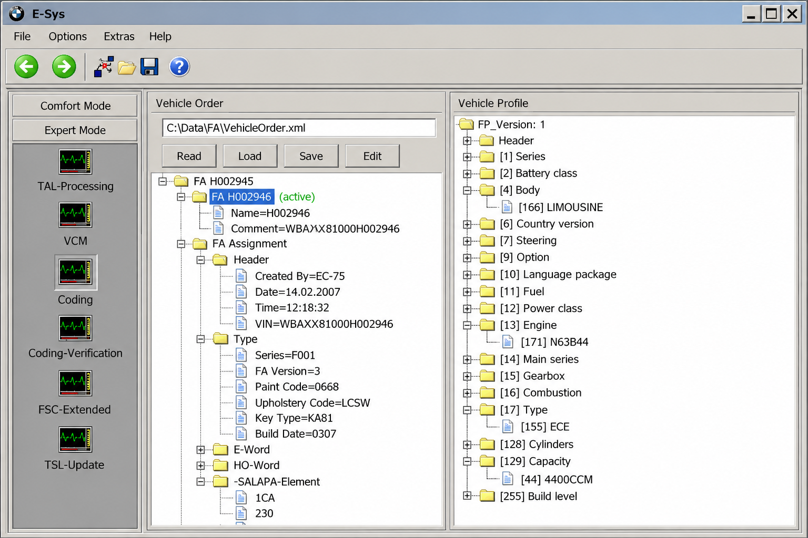
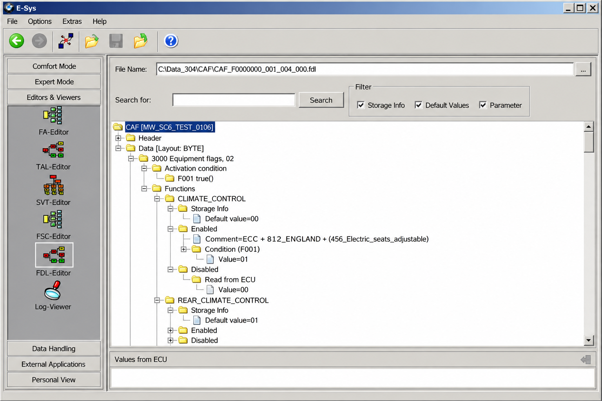
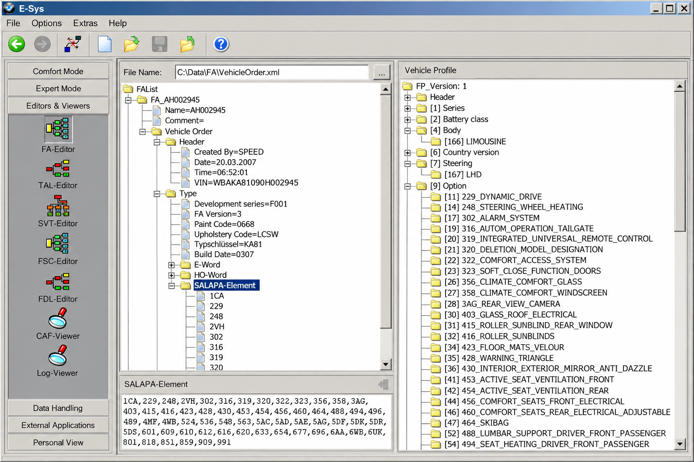

# BMW E-Sys Coding Tutorial - Practical BMW ECU Coding And Programming Reference

## Project Description

**BMW E-Sys Coding Tutorial** is an E-Sys BMW reference maintained by **E-Sys BMW** for understanding vehicle connections, coding data, ECU identification, programming sessions, and secure coding workflows.

The repository combines a BMW E-Sys configuration guide with selected C# PSdZ client components.

### What is e-sys for BMW?

E-Sys is BMW engineering software used with compatible F-series, G-series, and newer vehicles. It communicates with control units, reads vehicle configuration data, performs BMW E-Sys FDL coding and BMW E-Sys VO coding, and supports specialized BMW E-Sys ECU programming operations.

Coding changes configuration parameters without necessarily replacing ECU firmware. Flashing ECUs with E-Sys is a higher-risk process that can deploy firmware and bootloader changes. **BMW E-Sys Coding Tutorial** distinguishes these operations so users do not treat ordinary coding and BMW E-Sys ECU flashing as interchangeable procedures.

The retained source illustrates vehicle detection, PSdZ communication, programming actions, secure coding models, integration levels, vehicle orders, ECU identifiers, and TAL execution. Start with the local [BMW coding notes](docs/BMW_Coding.md).

### Names Used In This Guide

e sys bmw, e-sys bmw, bmw e sys software, e sys bmw coding, BMW E-Sys coding tutorial, bmw, bmw-coding, ecu-coding, ecu-programming, vehicle-diagnostics, f-series, g-series, enet

## Features

- Explains the difference between coding with esys and ECU firmware programming.
- Covers BMW E-Sys F-series coding and BMW E-Sys G-series coding concepts.
- Maps vehicle orders, ECU identifiers, integration levels, and programming actions to retained C# models.
- Shows how connection, configuration, coding, and TAL services are separated.
- Documents safety checks for BMW F30 E-Sys coding, BMW F10 E-Sys work, and newer platforms.
- Provides a code-oriented foundation for studying BMW E-Sys PSdZData interactions.
- Identifies the role of a BMW E-Sys ENET cable in supported Ethernet-based vehicles.
- Separates this repository from unofficial installers, launchers, tokens, and firmware archives.

The main desktop client is defined by [PsdzClient.csproj](Tools/Psdz/PsdzClient/PsdzClient.csproj), while the supporting library is defined by [PsdzClientLibrary.csproj](Tools/Psdz/PsdzClientLibrary/PsdzClientLibrary.csproj). The primary solution is [Psdz.sln](Tools/Psdz/Psdz.sln).

## Binary Compatibility

The retained code is a C# and .NET reference around BMW programming and PSdZ service concepts.

Compatibility depends on the operating environment, .NET dependencies, E-Sys release, PSdZ service version, vehicle platform, integration level, and data package. Searches for E Sys 3.30 1, E Sys 3.27 1, or E Sys latest version do not establish compatibility by themselves.

The [PSdZ configuration model](Tools/Psdz/PsdzClientLibrary/PsdzClient/PsdzConfig.cs), [service gateway](Tools/Psdz/PsdzClientLibrary/PsdzClient/PsdzServiceGateway.cs), and [64-bit path resolver](Tools/Psdz/PsdzClientLibrary/PsdzClient/Psdz64BitPathResolver.cs) show where environment-sensitive behavior is represented.

## Android

A phone application, generic OBD application, or infotainment integration project is not equivalent to BMW E-Sys ECU programming. Mobile tools may expose selected convenience functions, but they do not automatically provide the same vehicle-order, TAL, PSdZ, secure coding, or flashing capabilities.

## Hints

- Use a regulated power supply before programming or flashing an ECU.
- Confirm the chassis, target series, integration level, and PSdZData compatibility before connecting.
- Read and preserve the original FA, SVT, CAFD, and coding data before making changes.
- Change one coding objective at a time and retain a recovery record.
- Never interrupt BMW E-Sys ECU flashing by disconnecting power, Ethernet, or the computer.
- Treat copied E Sys BMW coding lists as starting points, not universal instructions.
- Verify that every option applies to the exact ECU and software level in the vehicle.
- Do not experiment with safety, restraint, braking, steering, immobilizer, or high-voltage modules.

## Patching

**BMW E-Sys Coding Tutorial** does not patch, crack, unlock, or modify E-Sys binaries. The retained code models service communication and programming data rather than instructions for bypassing licensing or security.

### Targeting Methods

Programming must target an identified vehicle and the intended ECU. The code represents these concepts through [EcuId](Tools/Psdz/PsdzClientLibrary/BMW/Rheingold/Programming/API/EcuId.cs), [EcuObj](Tools/Psdz/PsdzClientLibrary/BMW/Rheingold/Programming/API/EcuObj.cs), [VehicleOrder](Tools/Psdz/PsdzClientLibrary/BMW/Rheingold/Programming/API/VehicleOrder.cs), and [IntegrationLevelTriple](Tools/Psdz/PsdzClientLibrary/BMW/Rheingold/Programming/API/IntegrationLevelTriple.cs).

A valid target should be established from vehicle data instead of assumptions based only on a model badge. BMW F30 E-Sys and BMW F10 E-Sys searches can identify a general platform, but production date, ECU generation, installed options, and current integration level still matter.

### Apply The Patch

No assembly or firmware patch should be applied from this repository. A normal e sys bmw coding operation writes approved configuration data, while flashing ECUs with E-Sys executes a programming plan. Review the generated plan, selected ECU set, dependencies, and expected actions before execution.

## Installation

Review [App.config](Tools/Psdz/PsdzClient/App.config), [Program.cs](Tools/Psdz/PsdzClient/Program.cs), and the solution before attempting a local build.

| Component | Purpose |
|:--|:--|
| BMW E-Sys software | Provides the engineering interface used for supported BMW coding and programming workflows. |
| BMW E-Sys PSdZData | Supplies vehicle-specific coding and programming data compatible with the selected release. |
| BMW E-Sys ENET cable | Connects a compatible Ethernet-based BMW platform to the computer. |
| Stable vehicle power | Protects modules against voltage loss during coding or flashing. |
| This repository | Provides the BMW E-Sys Coding Tutorial and selected PSdZ-oriented C# references. |

### How do I set up ESysUltra?

Its license, installer, activation process, supported E-Sys releases, and interface can change independently of this repository.

First establish a working E-Sys installation with a compatible PSdZData package. Then verify the E-Sys executable path, PSdZData location, target series, and network adapter before configuring ESysUltra. Install and activate ESysUltra through its authorized distribution process, then select the matching E-Sys environment inside its configuration interface.

Before connecting to a vehicle, confirm that ESysUltra can open the configured environment without path or data errors. Connect the BMW E-Sys ENET cable, select the correct chassis target, read the vehicle order, and save an untouched backup before performing BMW E-Sys FDL coding or BMW E-Sys VO coding. Do not use a launcher to conceal an incompatible E-Sys or PSdZData combination.

## Usage

A cautious BMW coding E-Sys workflow follows a defined sequence:

1. Identify the vehicle, chassis, production date, and current integration level.
2. Prepare stable power and connect the BMW E-Sys ENET cable.
3. Configure the correct target series and BMW E-Sys PSdZData path.
4. Establish the vehicle connection without initiating programming.
5. Read and save the FA, SVT, ECU data, and original coding data.
6. Decide whether the task requires FDL coding, VO coding, FSC handling, or ECU programming.
7. Review every selected action before writing data.
8. Verify ECU status after completion and preserve the session records.

The retained [ConnectionManager](Tools/Psdz/PsdzClientLibrary/BMW/Rheingold/Programming/ConnectionManager.cs), [DetectVehicle](Tools/Psdz/PsdzClientLibrary/PsdzClient/DetectVehicle.cs), and [ProgrammingJobs](Tools/Psdz/PsdzClientLibrary/PsdzClient/ProgrammingJobs.cs) files illustrate the separation between discovery, connection, and programming work.

### Callbacks

Programming clients report progress, state changes, current ECU changes, and failures asynchronously. The relevant retained types include [PsdzProgressListener](Tools/Psdz/PsdzClientLibrary/BMW/Rheingold/Programming/ProgrammingEngine/PsdzProgressListener.cs), [ProgrammingEventManager](Tools/Psdz/PsdzClientLibrary/BMW/Rheingold/Programming/ProgrammingEngine/ProgrammingEventManager.cs), and [ProgrammingFailure](Tools/Psdz/PsdzClientLibrary/BMW/Rheingold/Programming/ProgrammingFailure.cs).

A caller should treat a progress notification as status information, not proof that a programming operation completed successfully. Final ECU state, session state, and reported failures must all be checked.

## Car Resources

E-Sys relies on vehicle-specific data rather than generic CAN definitions alone. The correct BMW E-Sys PSdZData package must match the workflow and should come from an authorized source.

An ESys FSC import should use a legitimate FSC associated with the intended vehicle and feature.

The retained [PsdzDatabase](Tools/Psdz/PsdzClientLibrary/PsdzClient/PsdzDatabase.cs), [PsdzDatabaseGeneration](Tools/Psdz/PsdzClientLibrary/PsdzClient/PsdzDatabaseGeneration.cs), and [XepConverter](Tools/Psdz/PsdzClientLibrary/PsdzClient/XepConverter.cs) indicate how strongly vehicle workflows depend on structured data.

## Overview

The repository is divided into a desktop client, a client library, BMW programming models, secure coding models, programming-engine events, and PSdZ service clients.

| Area | Representative file |
|:--|:--|
| Desktop entry point | [Program.cs](Tools/Psdz/PsdzClient/Program.cs) |
| Main client interface | [FormMain.cs](Tools/Psdz/PsdzClient/FormMain.cs) |
| Vehicle context | [ClientContext.cs](Tools/Psdz/PsdzClientLibrary/PsdzClient/ClientContext.cs) |
| Programming session | [ProgrammingSession.cs](Tools/Psdz/PsdzClientLibrary/BMW/Rheingold/Programming/ProgrammingEngine/ProgrammingSession.cs) |
| Secure coding | [SecureCodingServiceClient.cs](Tools/Psdz/PsdzClientLibrary/BMW/Rheingold/Psdz/Client/SecureCodingServiceClient.cs) |
| TAL execution | [TalExecutionServiceClient.cs](Tools/Psdz/PsdzClientLibrary/BMW/Rheingold/Psdz/Client/TalExecutionServiceClient.cs) |

## Getting Started

Read [BMW_Coding.md](docs/BMW_Coding.md) before reviewing the implementation. Then inspect the solution, project files, application configuration, vehicle detection, connection management, and programming service boundaries.

### Is esys free for BMW?

E-Sys is not presented here as a free consumer application. Publicly downloadable packages may be outdated, altered, incomplete, or distributed without permission.

## User Guide

For configuration work, begin with a read-only connection and preserve the original state. BMW E-Sys FDL coding changes individual parameters, while BMW E-Sys VO coding derives ECU configuration from the vehicle order.

For BMW E-Sys ECU programming, inspect the intended software deployment, integration level, ECU dependencies, and recovery requirements. The [ProgrammingObjectBuilder](Tools/Psdz/PsdzClientLibrary/BMW/Rheingold/Programming/API/ProgrammingObjectBuilder.cs), [ProgrammingAction](Tools/Psdz/PsdzClientLibrary/BMW/Rheingold/Programming/ProgrammingAction.cs), and [TalLineHelper](Tools/Psdz/PsdzClientLibrary/BMW/Rheingold/Programming/TalLineHelper.cs) provide code-level reference points.

## Development Status

**BMW E-Sys Coding Tutorial** is a curated technical reference.

The retained files emphasize BMW programming architecture and keep the main language focused on C#. Missing external dependencies, proprietary services, runtime data, or unselected source files may prevent a complete build.

## Implemented Features

- Vehicle and target detection models.
- Connection and configuration service clients.
- ECU, FA, SVT, integration-level, and SGBM identifiers.
- Programming session and event models.
- TAL execution and progress reporting.
- Secure coding request, response, status, and signed NCD models.
- Programming failure and recovery-state representations.
- BMW E-Sys vehicle connection guide material through code and documentation.

## Integration Points

The selected architecture separates service concerns through dedicated clients:

- [ConfigurationServiceClient](Tools/Psdz/PsdzClientLibrary/BMW/Rheingold/Psdz/Client/ConfigurationServiceClient.cs) handles configuration-service access.
- [ConnectionFactoryServiceClient](Tools/Psdz/PsdzClientLibrary/BMW/Rheingold/Psdz/Client/ConnectionFactoryServiceClient.cs) supports connection creation.
- [EcuServiceClient](Tools/Psdz/PsdzClientLibrary/BMW/Rheingold/Psdz/Client/EcuServiceClient.cs) represents ECU operations.
- [ProgrammingServiceClient](Tools/Psdz/PsdzClientLibrary/BMW/Rheingold/Psdz/Client/ProgrammingServiceClient.cs) represents programming operations.
- [ObjectBuilderServiceClient](Tools/Psdz/PsdzClientLibrary/BMW/Rheingold/Psdz/Client/ObjectBuilderServiceClient.cs) constructs service objects.
- [LogicServiceClient](Tools/Psdz/PsdzClientLibrary/BMW/Rheingold/Psdz/Client/LogicServiceClient.cs) exposes logic-service operations.

## Requirements

### How much does e-sys cost?

There is no single verified E Sys BMW price that applies to every user. Costs can depend on authorized software access, data access, support arrangements, a compatible BMW E-Sys ENET cable, stable power equipment, and any separately licensed launcher or training material.

Free forum packages should not be assumed to be authorized, current, complete, or safe.

## Developer Guide

Open [Psdz.sln](Tools/Psdz/Psdz.sln) in a compatible .NET development environment. Review [Directory.Build.props](Tools/Psdz/Directory.Build.props), the desktop [project file](Tools/Psdz/PsdzClient/PsdzClient.csproj), and the library [project file](Tools/Psdz/PsdzClientLibrary/PsdzClientLibrary.csproj) before resolving dependencies.

Keep connection discovery, read-only inspection, coding, and programming operations separate. New code should surface progress, cancellation, failure, target identity, and voltage-related preconditions explicitly.

## Privacy

The retained desktop configuration may contain local paths, addresses, logs, or vehicle identifiers. Do not commit VINs, FSC material, tokens, certificates, diagnostic logs, NCD backups, or customer vehicle data.

Review [App.config](Tools/Psdz/PsdzClient/App.config) and [log4net_config.xml](Tools/Psdz/PsdzClient/log4net_config.xml) before running the client. Store backups securely and remove identifying data before sharing diagnostic evidence.

## DBC File Basics

A DBC file describes CAN messages and signals. It is not the same as BMW E-Sys PSdZData, an NCD file, a CAFD description, a vehicle order, or a TAL.

Generic CAN reverse engineering can help explain bus traffic, but it does not replace the validated data and service workflow required for BMW E-Sys ECU programming. **BMW E-Sys Coding Tutorial** focuses on BMW programming structures rather than providing a reverse-engineered DBC collection.

## Quick Start

1. Read [BMW_Coding.md](docs/BMW_Coding.md).
2. Review the [solution](Tools/Psdz/Psdz.sln) and both project files.
3. Inspect [PsdzConfig.cs](Tools/Psdz/PsdzClientLibrary/PsdzClient/PsdzConfig.cs).
4. Follow vehicle detection into [DetectVehicle.cs](Tools/Psdz/PsdzClientLibrary/PsdzClient/DetectVehicle.cs).
5. Trace programming through [ProgrammingService.cs](Tools/Psdz/PsdzClientLibrary/BMW/Rheingold/Programming/ProgrammingService.cs).
6. Study TAL execution through [TalExecutionServiceClient.cs](Tools/Psdz/PsdzClientLibrary/BMW/Rheingold/Psdz/Client/TalExecutionServiceClient.cs).

### Project Structure

- `Tools/Psdz/PsdzClient` contains the desktop client.
- `Tools/Psdz/PsdzClientLibrary/PsdzClient` contains configuration, database, detection, and gateway components.
- `Tools/Psdz/PsdzClientLibrary/BMW/Rheingold/Programming` contains BMW programming abstractions.
- `Tools/Psdz/PsdzClientLibrary/BMW/Rheingold/Psdz/Client` contains PSdZ service clients.
- `docs` contains the retained BMW coding documentation.

## Validation

Before writing data, validate the vehicle identity, ECU target, integration level, connection stability, supply voltage, PSdZData compatibility, and recovery plan. After the operation, verify completion state, ECU availability, fault memory, and intended configuration.

## Safety Model

Read-only inspection is the safest default. Coding should remain blocked until the target and backup are confirmed, while programming should remain blocked until stable power, compatible data, and a reviewed execution plan are available.

## Code Rigor

Programming code should fail closed, preserve detailed errors, expose cancellation carefully, and avoid silently selecting fallback targets. Changes should keep nullable state, vehicle identity, ECU identity, and service lifecycle explicit.

The event models, progress listener, programming session, and failure types should be reviewed together when extending **BMW E-Sys Coding Tutorial**.

## FAQ

The four primary setup and licensing questions are answered in their relevant sections above. For coding procedures, start with the local BMW coding guide and then follow the corresponding connection, configuration, secure coding, or programming classes.

## Terms

- **FA:** The vehicle order describing configured equipment.
- **SVT:** The ECU topology and software-related vehicle structure.
- **CAFD:** Coding application data associated with an ECU.
- **NCD:** ECU coding data used in coding workflows.
- **PSdZData:** Vehicle-specific data used by E-Sys and related programming services.
- **FDL coding:** Editing individual ECU coding parameters.
- **VO coding:** Coding an ECU from the vehicle order.
- **TAL:** A transaction list describing planned programming actions.
- **ENET:** The Ethernet-based connection commonly used with supported BMW platforms.
- **FSC:** An enabling-code mechanism associated with supported vehicle features.

## More Resources

Use the retained [BMW coding guide](docs/BMW_Coding.md), [README reference](README.rst), programming API models, secure coding models, and PSdZ client classes as the repository’s local resources.

## Credits

**E-Sys BMW** maintains **BMW E-Sys Coding Tutorial** as an educational source reference.

### Copyright And License

Review [LICENSE](LICENSE).
